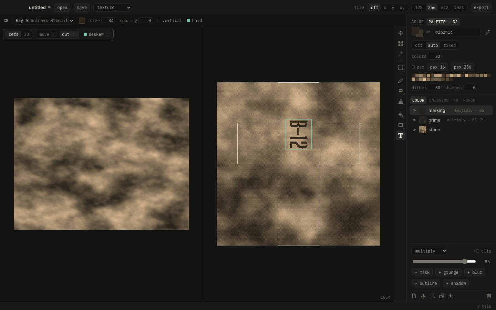

```
 █▀█ ▄▀█ █▀ ▀█▀ █▀▀ █ █ █▀█
 █▀▀ █▀█ ▄█  █  ██▄ █▄█ █▀▀
 ▓▓▒▒░░  cut · paste · crunch
```

A small image editor for crunchy retro textures, PS1 and Quake style. Cut pieces from photos, lay them onto a model's UVs, paint and crunch them down to a palette, and watch it live in Blender.



## What it does

- **Cut:** drop photos into the ref space and cut pieces out. Four-corner cuts come out straightened.
- **Paste:** lay the pieces onto the UV islands, then move, scale, turn and clip them to an island.
- **Paint:** texel-exact brush, fill, gradients, shapes and lines, plus layers with blend modes, masks, grunge and adjustments.
- **Channels:** color, emission, ao and roughness, each a stack of its own.
- **Crunch:** a palette (computed, Quake, Quake 2, Lospec or a file), Bayer dither, sharpen and PS1 15-bit color.
- **3D:** the model with the texture as you paint it, at game resolution if you like.
- **Blender:** one texture per material, written into the material's own images. Select an object and pasteup shows its texture. Strokes painted in Blender come back as a layer.
- **Safe:** unsaved sessions survive crashes, and texture files pasteup didn't write are backed up before it overwrites them.

## Run

Needs Go, Node and [Wails](https://wails.io) v2 (`make` installs Wails when it's missing).

```sh
make dev       # app window, plus http://localhost:34115 in a browser
make build     # bin/pasteup.app
make install   # into /Applications
make dist      # dist/: macOS (universal) and Windows zips, each with the Blender add-on
make test
```

## Blender

Install `tools/blender/pasteup_bridge.py` via Preferences › Add-ons › Install from Disk, save the `.blend`, select an object and press **sync** in the sidebar tab **pasteup**.

## Grunge maps

pasteup ships only generated noise and clouds. Drop your own square, tileable gray maps (white = dirt, PNG or JPG) into `~/Library/Application Support/pasteup/grunge`; **maps folder…** in a grunge mask's map list opens it.

## License

MIT, see [LICENSE](LICENSE). IBM Plex Mono is under the SIL Open Font License; the Quake 2 palette comes from func_godot (MIT).

## Help

Press `?` or `F1` in the app: the docs from [`docs/`](docs) and every key.
