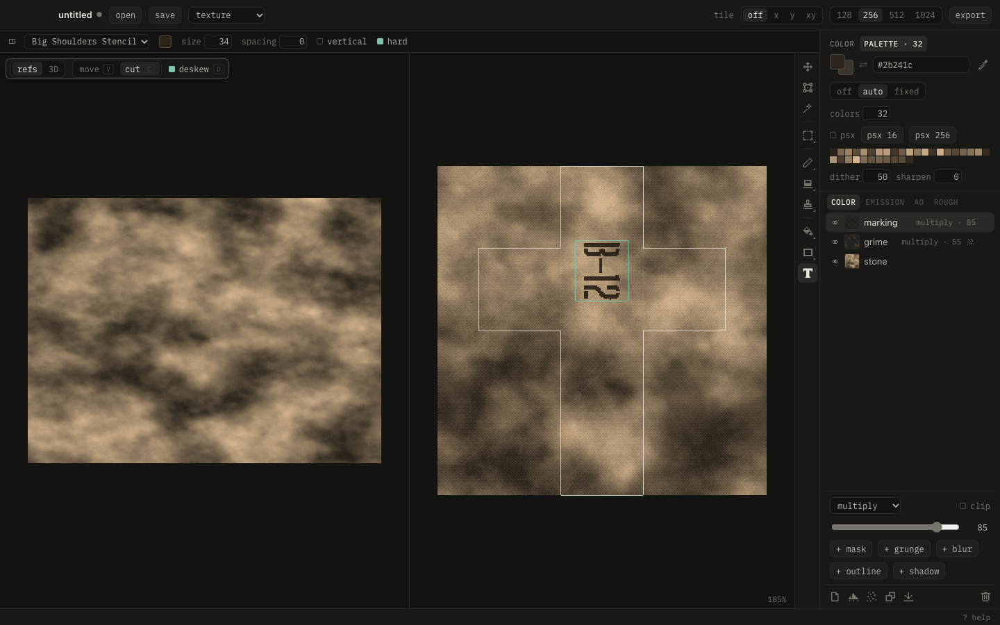

# Start

1. **⌘O** a GLB, or send objects from Blender with the add-on.
2. Drop photos left, **C** cut a piece, **Enter** places it.
3. **F** over an island fits the piece onto it. Paint, clone, fill, add grunge.
4. Palette tab: pick a palette, dither.
5. **⌘S** save. **⌘⇧E** export. With Blender connected, it's already there.

**?** shows every key.

## Tools

| | Key | |
|---|---|---|
| :move: | V | move the layer |
| :transform: | T | scale, turn, flip |
| :island: | I | clip the layer to an island |
| :select: | M | select, ⇧M lasso |
| :brush: | B | brush, right button: second color |
| :eraser: | E | eraser |
| :clone: | S | clone, ⌥ click: source in the canvas or a photo |
| :fill: | G | fill, ⇧G gradient |
| :rect: | U | shapes, L line |

**⌥ click** picks a color. **Q** paints the layer's mask. **Esc** drops a selection.
