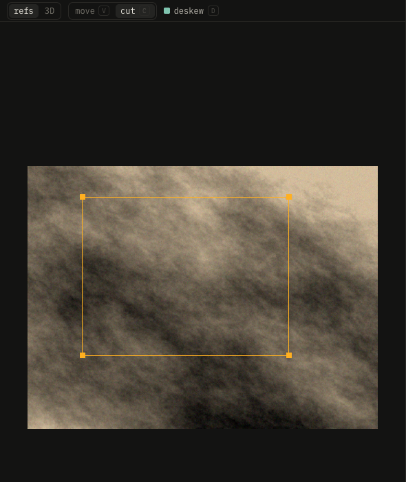

# Refs

Drop photos here, or right-click → open images.

| Key | Effect |
|---|---|
| V | move: drag photos around |
| C | cut: drag a rectangle, then drag its corners onto the shape |
| ⇧ drag | cut: a square |
| ⌥ drag a corner | without snapping |
| D | deskew on or off |
| Enter | place the piece on the canvas, as a new layer |
| Esc | drop the cut |
| Backspace | remove the selected photo |
| two fingers, pinch | pan, zoom |
| ⌘0 | fit the photos |

Corners snap level and mirrored; turquoise guides show it. Deskew straightens the cut into a rectangle; off, it keeps the photo's shape.
