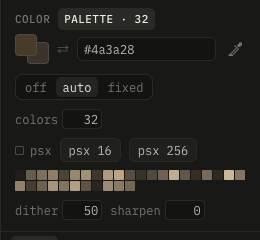

# Palette and finish

The finish is the last step over the color channel: sharpen, then ordered dither, then each texel to its nearest palette color. Layers stay as they are; the canvas, the 3D view, the export and Blender show the finished color.

The color tab of the color panel:

| Setting | Effect |
|---|---|
| list | the colors shown: your swatches, the project's palettes, the built-in ones (quake, quake 2, gameboy, rosy 42, resurrect 64, endesga 64, pico-8, nes, snes, lospec500) |
| lospec… | a palette from lospec.com by its slug (as in lospec.com/palette-list/pico-8) |
| file… | a palette file: .lmp, .gpl, .hex, or the colors of an image |
| colors | click: primary color, right-click: secondary |

Choosing a palette only shows it; finish → palette maps the texture to it.

The finish tab:

| Setting | Effect |
|---|---|
| off, palette, auto | no palette, the chosen one, or one computed from the texture |
| colors (auto) | how many: 2–256; the palette follows the texture once edits rest, and stays steady |
| dither | 4×4 Bayer before the palette, so gradients break into patterns |
| psx | the PS1's 15-bit color (32 steps a channel), after the palette too |
| psx 16, psx 256 | the PS1's texture look in one go: auto with 16 or 256 colors, 15-bit |
| sharpen | crisper edges before the palette |

Palettes and the finish are saved with the project.

The PS1 has no fixed palette: a texture has 15-bit color, or a table of 16 or 256 colors (4 or 8 bit) that are 15-bit themselves; psx with auto 16 or 256 is that.
