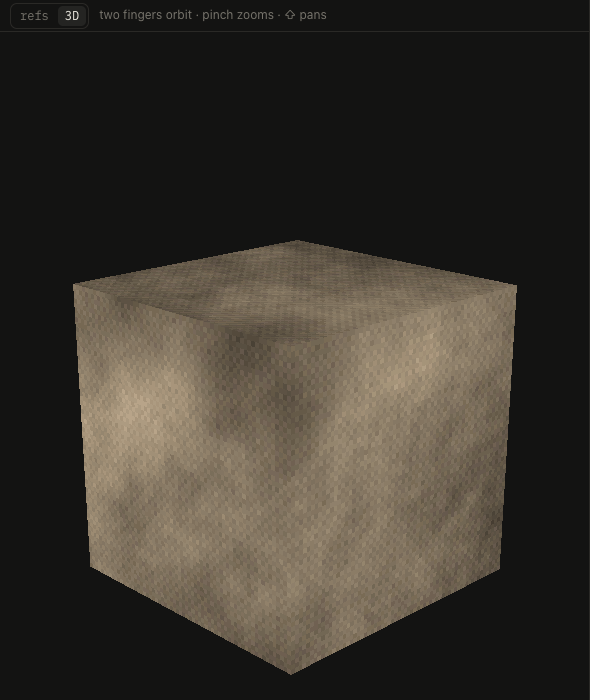

# 3D view

The ref area shows the photos or the model in 3D: the switch in its bar, or `.

| Input | Effect |
|---|---|
| two fingers, drag | orbit |
| pinch, ctrl + scroll | zoom in towards the cursor, out back towards the model |
| ⇧ two fingers, ⇧ drag, right drag | pan |
| ⌘0, frame | frame the model |
| lit, flat | light from the camera, or the texture as it is |
| bloom | how strongly glowing parts bloom, 10 to start; 0 is off |
| P, full / 480p / 360p / 240p | render at a game's resolution, to see the texture at game size |

The model is the one whose UVs show, opened or synced from Blender. It shows the texture as it is written, with AO multiplied in unless kept apart, and the emission glowing; texels stay crisp up close and calm far away, like Godot's nearest_mipmap. It follows painting a few times a second. The pivot stays on the model: panning and zooming never take it outside the model's bounds.
